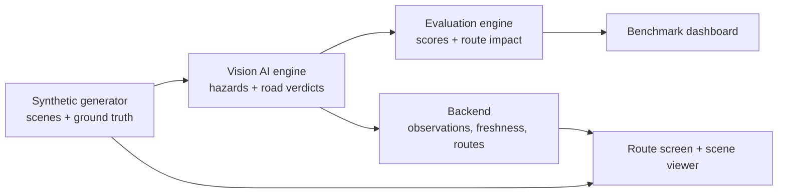

# DisasterLens

**Disaster-scene and route-obstruction understanding** - a Visual Task Factory hackathon project.

> **Status:** Planning phase (development window 22 - 28 November 2026). This repository currently contains the project description and implementation plans. Code will be added module by module following the plan in [`docs/`](docs/).

> **Safety notice:** DisasterLens is a research prototype that works on **synthetic (computer-generated) scenes**. It is **not** a certified navigation or emergency-response system. It never claims that a road or route is "safe". It reports only that *no obstruction was detected in imagery captured at a given time*. An image cannot show water depth, hidden damage, structural integrity or official road closures.

---

## 1. The problem

After floods, storms or earthquakes, a scene may contain debris, damaged buildings, standing water and blocked roads. Understanding it means two things:

1. **Finding the hazards** that are visible.
2. **Reasoning about how they affect movement** - does a hazard actually interrupt a road, or does it only appear near it?

Today's vision AI models can often recognise flood water or debris, but it is much less clear whether they understand the *spatial relationship* between a hazard and a road. A pile of debris beside a road should not automatically make that road "blocked", and a flood covering the full road width should not be missed.

There is a second, practical problem. A person who has already reached a disaster-affected location can usually see an obstruction for themselves. The useful moment is **before** travelling: knowing which roads were recently seen to be obstructed, and which alternative route is available. But old images must never be treated as current evidence.

## 2. Our solution

DisasterLens has two connected parts.

| Part | What it does | Why it matters |
|---|---|---|
| **A. Benchmark (main contribution)** | Generates controlled synthetic disaster-city scenes with exact ground truth, asks vision models structured questions about them, and scores the answers. | Measures whether models truly understand hazards and road obstruction, and shows where they fail at spatial reasoning. |
| **B. Route finder (application)** | Stores road conditions from images together with timestamps, marks old observations as stale, finds the best route and recommends an alternative with an explanation when the preferred route is blocked. | Shows how the benchmark's model outputs would be used in a real decision-support tool. |

**The link between A and B:** we measure how often a model's mistakes would send a user along a route that really contains a blocked road. This is called *route impact*.

### Part A - Benchmark ("Visual Task Factory")

1. Generate a simplified city grid with roads, buildings and disaster features (flood areas, debris, fallen trees, road damage, damaged-building symbols).
2. Store exact hazard positions, damage labels and road connectivity as **ground truth**, checked by an independent validator.
3. Ask vision models structured questions about each scene.
4. Compare predictions with ground truth and calculate metrics.
5. Analyse failures, especially hazard-near-road versus hazard-blocking-road cases.

**Example benchmark questions**

- Which road segments are blocked by debris or water?
- How many buildings are visibly damaged?
- Where are the regions of standing water?
- Is the route between two points obstructed?
- Which of two zones has more visible hazard?

**Dataset:** 100 reproducible scenes (seed 2026), 5 hazard types, 3 difficulty levels, split into 30 tuning scenes and 70 final test scenes. Prompts are tuned only on the tuning scenes.

### Part B - Time-aware route finder

1. Images of roads are uploaded in advance with their capture time.
2. Each image is analysed for hazards, which are mapped to specific road segments.
3. Every segment gets a condition: **Blocked, Partial, Clear (no obstruction detected), Uncertain, Stale or Unknown**.
4. The user enters a start and a destination.
5. The system calculates the best route and, if it is blocked, recommends an alternative and explains why.
6. New images update the affected segments and trigger a reassessment of saved routes.

**Time awareness:** the system tracks capture time, upload time, analysis time, source, confidence and freshness. An outdated image shows a road as *Stale* or *Unknown*, never as clear.

## 3. How it fits together



## 4. Key rules

| Question | Rule |
|---|---|
| Does a hazard block a road? | Cut the road segment into 20 cross-sections. If a hazard covers 90% or more of the road width at some point, the road is **blocked**; 30-90% is **partial**; below 30% is **not blocked**, even if the hazard is next to the road. A damaged building alone never blocks a road. |
| How are roads represented? | As a graph: intersections are nodes and road segments are edges with IDs such as `SEG-014`. |
| When is an image too old? | Clear: fresh for 3 hours, stale after 12 hours. Blocked: trusted for 24 hours, then stale (still avoided, with a warning). No image: unknown. |
| How do new images update roads? | The newest capture time wins. A newer block beats an older clear. Changing from blocked to clear needs strong evidence. |
| How do we stop false "clear" answers? | A road is called clear only if the model listed what it saw, image quality is good and the whole road is visible. Disagreement between the model and the geometry check becomes *uncertain*. |
| How are alternatives validated? | A checker confirms that the route is connected and contains no fresh blocked road before it is shown. |
| How do we demo without live feeds? | Pre-made time-stamped images, a simulated clock and a "submit next image" button. |

## 5. How models are scored

| Task | Measures |
|---|---|
| Hazard detection | Precision, recall, F1 (IoU 0.5) |
| Road status | Per-class F1, confusion matrix |
| Safety | **False-clear rate**, false-block rate, uncertain rate |
| Building count | Exact match, mean error |
| Water regions | IoU |
| Route obstruction | Accuracy, including near-miss cases |
| Zone comparison | Accuracy |
| Reliability | Valid-JSON rate, latency, accuracy by difficulty |
| Route impact | How often a chosen route crosses a truly blocked road |

Simple baselines (always-clear, proximity-only, noisy oracle) are reported next to every model result. Mock results are always labelled as mock.

## 6. Technology

| Area | Technologies |
|---|---|
| Frontend | React, Vite, TypeScript, Tailwind CSS, TanStack Query, Recharts |
| Backend | Python 3.11, FastAPI, Pydantic v2, SQLAlchemy, SQLite |
| Scene generation | Python, Pillow, NumPy, Shapely |
| Vision AI | Model-agnostic adapter for a vision-capable model API, JSON-schema output, response cache, mock mode |
| Routing | NetworkX (Dijkstra, k-shortest paths) |
| Testing and CI | pytest, ruff, TypeScript compiler, GitHub Actions |
| Hosting | Vercel (frontend), Render (backend), GitHub |

Deliberately not used: Kubernetes, microservices, custom model training, heavy GIS software.

## 7. Planned repository structure

```
disasterlens/
├── dl/
│   ├── contracts/    shared data formats
│   ├── generator/    synthetic scenes and ground truth
│   ├── vision/       model adapter, mapper, guards, runner
│   ├── evaluation/   scoring and route impact
│   ├── routing/      graph, freshness, fusion, route engine
│   └── api/          backend endpoints
├── frontend/         dashboard, scene viewer, route screen
├── tests/  fixtures/  datasets/  scenarios/  results/
├── docs/             implementation plans and specifications
└── scripts/
```

## 8. Team and ownership

| Member | Main responsibility |
|---|---|
| **Rishikesh** | Overall handling (repository, shared data formats, daily integration checks, deployment, submission) plus the evaluation engine and benchmark dashboard |
| **Tejash** | Synthetic scene generator, ground truth, scene viewer, scenario player, demo city |
| **Divyanshu** | Vision AI engine, hazard-to-road mapper, safety guards, runner and baselines |
| **Rajneesh** | Backend, road graph, freshness, route engine, route screen |

## 9. Timeline (22 - 28 November 2026)

| Day | Focus |
|---|---|
| 1 | Repository, shared data formats frozen, skeletons and sample files |
| 2 | Core module logic: hazards and ground truth, mapper, freshness, first metrics |
| 3 | First end-to-end chain with baselines; route engine |
| 4 | Real vision wired into the backend; scene viewer and demo city; dataset v1.0 |
| 5 | Full test-set runs, dashboard completion, deployment |
| 6 | Cross-testing in pairs, feature freeze at 15:00, documentation |
| 7 | Final checks, release `v1.0.0`, demo rehearsals, submission |

## 10. Documentation

- [Main implementation plan](docs/implementation-plan/00_Main_Implementation_Plan.pdf)
- Individual plans:
  - [Rishikesh](docs/implementation-plan/individual/1_Rishikesh_Implementation_Plan.pdf)
  - [Tejash](docs/implementation-plan/individual/2_Tejash_Implementation_Plan.pdf)
  - [Divyanshu](docs/implementation-plan/individual/3_Divyanshu_Implementation_Plan.pdf)
  - [Rajneesh](docs/implementation-plan/individual/4_Rajneesh_Implementation_Plan.pdf)

## 11. Contributing workflow

- Branches: `feat/<name>/<topic>`. No direct pushes to `main`.
- Small pull requests, reviewed within 2 hours, CI must pass.
- Each member edits only their own folders; shared data-format changes go through a small announced pull request.
- API keys live only in hosting environment settings, never in the repository.

## 12. Limitations

- Scenes are synthetic and simplified; results say nothing about performance on real disaster imagery.
- The system assumes images come from registered camera views with known geometry.
- Imagery cannot establish water depth, hidden damage, structural integrity or official closures.
- Freshness thresholds are assumptions for the prototype, not empirically derived.
- No real-time disaster feed, satellite or government data is used.

## 13. Setup and usage

Setup instructions, demo scenarios and run commands will be added to this README as each module is completed.
