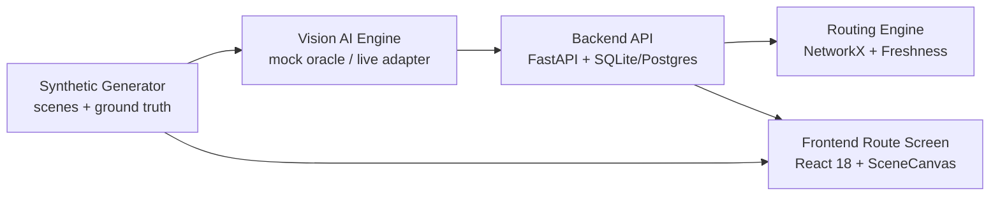

# DisasterLens

**Disaster-Scene and Route-Obstruction Understanding** — A Visual Task Factory Hackathon Project.

> **Status:** **Core Implementation Complete (Phases 1–6).**
> The backend foundation, road graph network, table-driven freshness decay, multi-observation fusion engine, condition-aware route recommendation engine, RESTful API, and interactive React route screen are fully implemented and verified with 106 passing regression tests, 96.1% routing engine coverage, clean Ruff linting, and production Vite/TypeScript builds.

> **Safety Notice & Research Prototype Disclaimer:**
> DisasterLens is a research prototype that operates strictly on **synthetic (computer-generated) disaster scenes**. It is **not** a certified navigation, emergency dispatch, or life-safety system. It never claims that a road or route is "safe". It reports only that *no obstruction was detected in imagery captured at a given timestamp*. An image cannot establish water depth, roadbed stability, structural integrity, or official road closure mandates.

---

## 1. Project Overview

DisasterLens addresses a critical gap in computer vision applications for disaster response: **spatial reasoning about road obstruction versus proximity**. When disaster strikes, piles of debris or floodwaters near a road should not trigger false blockages, while full-width road inundations must be reliably detected and detoured around.

The platform links benchmark evaluation with decision support:
1. **Part A — Benchmark:** Evaluates vision models on controlled synthetic disaster-city scenes with exact ground truth (generated with raster cross-section analysis).
2. **Part B — Time-Aware Routing Engine & Dispatch Screen:** Integrates road topology, multi-source observations, exponential freshness decay, and conservative recovery gates to recommend emergency routes that detour around confirmed blockages.



---

## 2. Team and Architecture Responsibilities

| Member | Module / Domain | Responsibilities & Ownership |
| :--- | :--- | :--- |
| **Rishikesh** | System Lead & Evaluation | Repository coordination, evaluation metrics engine, benchmark dashboard, cloud deployment orchestration. |
| **Tejash** | Synthetic Scene Generation | Scene generator, ground truth generation, raster cross-section validation, scene viewer, scenario player. |
| **Divyanshu** | Vision AI Engine | Vision model adapter, prompt runners, hazard-to-road mapper, safety guards. |
| **Rajneesh** | Backend Foundation & Routing | Road graph, freshness decay, observation fusion, route recommendation engine, REST API, frontend Route Screen, automated test suite. |

---

## 3. Technology Stack

- **Backend:** Python 3.11 / 3.12, FastAPI, Pydantic v2, SQLAlchemy 2.0, NetworkX, PyYAML.
- **Frontend:** React 18, TypeScript 5, Vite, Tailwind CSS, TanStack Query v5, Lucide Icons.
- **Testing & Quality:** Pytest, Ruff linter, TypeScript compiler (`tsc --noEmit`).
- **Database:** SQLite (default for development and testing), PostgreSQL compatible via SQLAlchemy.

---

## 4. Getting Started from a Clean Clone

### Prerequisites
- **Python:** 3.11 or 3.12
- **Node.js:** 18.x or 20.x (with `npm`)
- **Git**

### 1. Repository Setup
```bash
git clone https://github.com/Rishikesh2298/DisasterLens.git
cd DisasterLens
```

### 2. Backend Setup
Create and activate a local Python virtual environment:
```bash
python3 -m venv .venv
source .venv/bin/activate
```

Install the backend package with development dependencies in editable mode:
```bash
pip install --upgrade pip
pip install -e '.[dev]'
```

Configure your environment variables:
```bash
cp .env.example .env
```
*(Default settings use `VISION_MODE=mock`, SQLite database, and port 8000).*

### 3. Frontend Setup
In a separate terminal tab:
```bash
cd frontend
npm install
```

---

## 5. Running the Application

### Start the Backend API Server
With the Python `.venv` activated:
```bash
uvicorn dl.api.main:app --reload --host 0.0.0.0 --port 8000
```
- API Base URL: `http://localhost:8000/api`
- Interactive OpenAPI Docs (Swagger UI): `http://localhost:8000/docs`
- Health Endpoint: `http://localhost:8000/api/health`

### Start the Frontend Web Application
```bash
cd frontend
npm run dev
```
Open `http://localhost:5173` (or `http://localhost:3000`) in your browser to view:
- **Emergency Routing Engine:** Condition-aware route calculation, baseline comparisons, interactive map overlays, and timeline controls.
- **Disaster Scenario Simulation:** Step-by-step camera playback through T0–T3 events.
- **Benchmark Dataset Viewer:** Inspection of synthetic scenes, buildings, and ground-truth hazards.

---

## 6. Running Tests & Quality Verification

All tests run fully sandboxed without external network or API keys:

```bash
# Run backend test suite (81 tests)
.venv/bin/pytest -v

# Run Ruff linter and code formatting check
.venv/bin/ruff check dl tests

# Run frontend TypeScript type-checking and production Vite build
cd frontend && npm run build
```

---

## 7. Implemented REST API Endpoints

The backend provides 12 endpoints under `/api`. Complete request/response schemas, error codes, and field definitions are documented in [`docs/api-contracts.md`](docs/api-contracts.md).

| Category | Method | Path | Description |
| :--- | :--- | :--- | :--- |
| **System** | `GET` | `/api/health` | Service health, DB connectivity, and safety disclaimer. |
| **Cities** | `GET` | `/api/cities` | List seeded cities (`DEMO-001`). |
| **Cities** | `GET` | `/api/cities/{city_id}` | Full topological graph (36 nodes, 60 edges, hazards). |
| **Segments** | `GET` | `/api/cities/{city_id}/segments` | Effective road conditions and freshness at `as_of`. |
| **Segments** | `GET` | `/api/segments/{segment_id}/history` | Persistent chronological observation audit trail. |
| **Observations** | `POST` | `/api/observations` | Ingest JSON or multipart image observation; emits route alerts. |
| **Routing** | `POST` | `/api/routes/recommend` | Condition-aware route with baseline, verifier, and explanation. |
| **Scenarios** | `GET` | `/api/scenarios` | List demonstration disaster scenarios. |
| **Scenarios** | `GET` | `/api/scenarios/{scenario_id}` | Scenario timeline steps and camera viewports. |
| **Scenarios** | `POST` | `/api/scenarios/{scenario_id}/advance`| Advance timeline (T0–T3), sync simulated clock, ingest events. |
| **Clock** | `GET` | `/api/clock` | Current simulated and wall-clock times. |
| **Clock** | `POST` | `/api/clock` | Manually configure or reset simulated clock time. |

---

## 8. T0–T3 Scenario Demonstration Workflow

The included demonstration scenario (`demo_city`) showcases how the engine handles evolving disaster conditions:

1. **Step T0 — Baseline State (Unobserved):**
   - Simulated Clock: `wall-clock` (`simulated_time: null`).
   - Observations: None. All road segments evaluate as `UNKNOWN` (3.0× exploration penalty).
   - Route: Direct shortest baseline route is selected with an advisory warning noting unverified segments.

2. **Step T1 — Flood Detection (Confirmed Obstruction):**
   - Simulated Clock: `2026-11-27T08:00:00+05:30`.
   - Event: Synthetic camera 1 detects a major flood covering $\ge$90% of corridor `SEG-001`.
   - Engine Verdict: `SEG-001` becomes `BLOCKED`.
   - Routing: Baseline route contains `SEG-001` and is marked invalid. Recommended route safely detours around `SEG-001`. Emits `PRIMARY_NOW_BLOCKED` route alert.

3. **Step T2 — Near-Miss Debris (No False Blockage):**
   - Simulated Clock: `2026-11-27T09:00:00+05:30`.
   - Event: Synthetic camera 2 detects debris adjacent to `SEG-005` (near-miss).
   - Engine Verdict: Near-miss rule applies. Road status is `CLEAR` (No obstruction detected). The corridor is not falsely blocked.

4. **Step T3 — Receding Water (Conservative Recovery Gate):**
   - Simulated Clock: `2026-11-27T10:00:00+05:30`.
   - Event: Camera 1 re-observes `SEG-001` with floodwater receding, but confidence is 0.65 (< 0.70 threshold) with partial visibility.
   - Engine Verdict: Recovery gate rejects immediate unblock. `SEG-001` transitions to `UNCERTAIN` (4.0× penalty). Advisory warning is emitted.

5. **Backward Navigation (T3 → T1 or Reset to T0):**
   - The frontend synchronizes the simulated clock, invalidates stale query caches, and immediately eliminates T3's advisory warnings when navigating back to T1 or T0.

---

## 9. Vision Mode Architecture & Status

Configured in `.env` via `VISION_MODE`:
- `mock` (**Default & Fully Operational**): Deterministic mock oracle. Re-creates exact observations from synthetic scenes and timeline steps. Fully tagged with `is_mock: true`.
- `cached` (**Unavailable / Stubbed**): Reserved for future pre-recorded vision cache repositories. Returns HTTP 500 `VisionProviderError`.
- `live` (**Unavailable / Stubbed**): Reserved for future live vision model APIs (e.g. Gemini 1.5 Flash). Returns HTTP 500 `VisionProviderError` unless live API keys and network adapters are provided.
*Note: Ground-truth mock output is never silently substituted for live model inference.*

---

## 10. Deployment Blueprint

Render deployment configuration is provided in [`render.yaml`](render.yaml). Production infrastructure and Render hosting accounts are owned and managed by the team lead (**Rishikesh**).

---

## 11. Limitations & Research Boundary

- Scenes and hazard intrusions are synthetic; results do not establish real-world disaster reliability.
- Freshness decay thresholds are heuristic prototype assumptions, not empirically measured disaster lifespans.
- The routing engine assumes camera views map to known road segment IDs.
- Never use this software for live emergency navigation or search-and-rescue dispatch.
