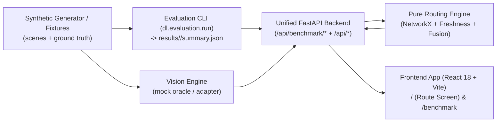

# DisasterLens

**Disaster-Scene Benchmark, Evaluation Engine, and Route-Obstruction Understanding** — A Visual Task Factory Hackathon Project.

DisasterLens is a synthetic-scene research benchmark and route-reasoning platform for measuring hazard recognition and road-obstruction understanding. It scores model predictions against exact generated-scene ground truth and demonstrates how observations, freshness decay, and recovery gates shape emergency route recommendations.

> **Safety Notice & Research Prototype Disclaimer:**
> DisasterLens is a research prototype that operates strictly on **synthetic (computer-generated) disaster scenes**. It is **not** a certified navigation, emergency dispatch, or life-safety system. A clear result indicates only that *no obstruction was detected in imagery captured at a given timestamp*; it does not establish water depth, roadbed stability, hidden damage, structural integrity, official road closures, or that a road or route is "safe".

---

## Current Implementation

- **Shared Data Contracts (`dl/contracts`):** Versioned (`0.1.0`) Pydantic v2 schemas for scenes, vision analysis, observations, freshness state, route recommendations, and evaluation datasets/summaries.
- **Modular Benchmark & Evaluation Engine (`dl/evaluation`):** Pure task scorers for hazard detection (IoU 0.5 & 0.3), road segment status, building counts, water regions, route obstruction, zone comparison, confidence calibration, route impact, and failure taxonomy (`false_clear`, `near_miss_false_block`, `invalid_output`, etc.), plus CLI `dl.evaluation.run`.
- **Backend Foundation & Persistence (`dl/api`):** FastAPI service with SQLAlchemy (SQLite/PostgreSQL), idempotent demo-city seeding, structured image upload storage, benchmark run endpoints (`/api/benchmark/*`), and scenario/clock/routing endpoints (`/api/*`).
- **Road Graph, Freshness, Fusion & Routing (`dl/routing`):** NetworkX road network builder, table-driven freshness decay (`freshness.yaml`), multi-observation temporal fusion (`captured_at`-ordered with recovery confidence/visibility gates), condition-aware Dijkstra & k-shortest alternatives, path verifier, and templated explanations.
- **Frontend Workspace (`frontend`):**
  - **Route Screen & Demo Player (`/`):** Condition-aware routing explorer, T0–T3 scenario timeline playback, and interactive SVG scene canvas.
  - **Benchmark Dashboard (`/benchmark`, `/compare`, `/failures`):** Model-vs-baseline comparison, difficulty breakdown charts, confusion matrix, failure browser, CSV export, and mock/live API switch.

---

## Architecture



---

## Team Responsibilities

| Member | Module / Domain | Responsibilities & Ownership |
| :--- | :--- | :--- |
| **Rishikesh** | System Lead & Evaluation | Repository coordination, shared contracts, modular evaluation engine, benchmark API (`/api/benchmark/*`), benchmark dashboard, deployment orchestration. |
| **Tejash** | Synthetic Scene Generation | Scene generator, ground-truth derivation, raster cross-section rules, SceneCanvas viewer, ScenarioPlayer, `demo_city` dataset. |
| **Divyanshu** | Vision AI Engine | Vision model adapter, prompt execution, hazard-to-road mapping, safety guards against false clear. |
| **Rajneesh** | Backend & Routing Engine | Road graph, freshness decay, observation fusion, route recommendation & verifier, REST API (`/api/*`), Route Screen frontend, backend & routing tests. |

---

## Prerequisites & Clean-Clone Setup

- **Python:** 3.11 or 3.12
- **Node.js:** 20 or later (with `npm`)

### 1. Backend Setup
```bash
git clone https://github.com/Rishikesh2298/DisasterLens.git
cd DisasterLens
python3 -m venv .venv
source .venv/bin/activate   # Windows: .\.venv\Scripts\Activate.ps1
python -m pip install --upgrade pip
python -m pip install -e ".[dev]"
cp .env.example .env
```

### 2. Frontend Setup
```bash
cd frontend
npm install
```
*(Optional: copy `frontend/.env.example` to `frontend/.env.local` to point the benchmark dashboard at the live local backend with mock mode disabled).*

---

## Running Locally

### Start the Unified Backend API
```bash
uvicorn dl.api.main:app --reload --host 0.0.0.0 --port 8000
```
- OpenAPI Docs (Swagger UI): `http://localhost:8000/docs`
- Health Check: `http://localhost:8000/api/health`

### Start the Frontend App
```bash
cd frontend
npm run dev
```
Open `http://localhost:5173`:
- **`/`**: Emergency Route Screen, T0–T3 Scenario Player, and Synthetic Scene Viewer.
- **`/benchmark`**, **`/compare`**, **`/failures`**: Benchmark Overview, Model Comparison, and Failure Browser.

### Run the Sample Benchmark Evaluation CLI
```bash
python -m dl.evaluation.run \
  --dataset fixtures/sample_dataset.json \
  --predictions fixtures/sample_predictions.json \
  --output results/sample-oracle \
  --run-name sample-oracle \
  --model-id fixture-oracle \
  --split dev \
  --mock
```

---

## API Endpoints

### Benchmark Results API (`/api/benchmark/*`)
| Method | Path | Purpose |
| :--- | :--- | :--- |
| `GET` | `/api/benchmark/health` | Benchmark service liveness (`synthetic_only: true`). |
| `GET` | `/api/benchmark/runs` | List available evaluated runs in `results/`. |
| `GET` | `/api/benchmark/runs/{run_id}` | Validated run summary JSON. |
| `GET` | `/api/benchmark/runs/{run_id}/failures` | Failure cases filtered by optional `category` and `difficulty`. |
| `GET` | `/api/benchmark/runs/{run_id}/scenes/{scene_id}` | Ground truth and prediction for a specific scene. |

### Application, Observation, Scenario & Routing API (`/api/*`)
Full request/response contracts are documented in [`docs/api-contracts.md`](docs/api-contracts.md).

| Method | Path | Purpose |
| :--- | :--- | :--- |
| `GET` | `/api/health` | Service health, DB status, active `VISION_MODE`, clock state, disclaimer. |
| `GET` | `/api/cities` | List seeded cities (`DEMO-001`). |
| `GET` | `/api/cities/{city_id}` | Full graph topology, zones, geometry, and scene image URLs. |
| `GET` | `/api/cities/{city_id}/segments` | Effective segment statuses, age, and freshness at `as_of`. |
| `GET` | `/api/segments/{segment_id}/history` | Chronological observation audit history for a segment. |
| `POST` | `/api/observations` | Ingest JSON or multipart image observation; returns `affected_segments` and alerts. |
| `POST` | `/api/routes/recommend` | Shortest baseline vs condition-aware recommended route, alternatives, verifier, explanation. |
| `GET` | `/api/scenarios` | List demonstration disaster scenarios (`demo_city`). |
| `GET` | `/api/scenarios/{scenario_id}` | Scenario timeline steps and camera viewports. |
| `POST` | `/api/scenarios/{scenario_id}/advance` | Advance timeline (T0–T3), sync simulated clock, ingest observations. |
| `GET` | `/api/clock` | Current simulated and wall-clock reference times. |
| `POST` | `/api/clock` | Set or reset simulated clock time. |

---

## Verification & Quality Checks

```bash
python -m pytest -q
python -m dl.contracts.check fixtures
ruff check dl tests
cd frontend
npm run format:check
npm audit --audit-level=moderate
npm run build
```

---

## Vision Mode Status & Deployment

- **`VISION_MODE=mock`** *(Operational default)*: Deterministic mock oracle tagged with `is_mock: true`.
- **`VISION_MODE=cached` / `live`** *(Stubbed until live adapter / cache integration)*: Explicitly raises `VisionProviderError` (HTTP 500) rather than silently substituting mock results.
- **Deployment Config:** Backend deployment is configured in [`render.yaml`](render.yaml) (Render) and frontend in `frontend/` (Vercel). Configure `CORS_ORIGINS` on Render and `VITE_API_BASE_URL` on Vercel.
- **Docs & Plans:**
  - [`docs/api-contracts.md`](docs/api-contracts.md) & [`docs/benchmark-spec.md`](docs/benchmark-spec.md)
  - [Main implementation plan](docs/implementation-plan/00_Main_Implementation_Plan.pdf)
  - Individual plans: [Rishikesh](docs/implementation-plan/individual/1_Rishikesh_Implementation_Plan.pdf), [Tejash](docs/implementation-plan/individual/2_Tejash_Implementation_Plan.pdf), [Divyanshu](docs/implementation-plan/individual/3_Divyanshu_Implementation_Plan.pdf), [Rajneesh](docs/implementation-plan/individual/4_Rajneesh_Implementation_Plan.pdf)

---

## Limitations & Safety Boundary

Scenes are synthetic and simplified. They cannot establish water depth, hidden damage, structural integrity, official road closures, or real-world vision model reliability. Freshness thresholds and route multipliers are prototype heuristics. Results are research measurements only and must never be used for live emergency response or navigation.
